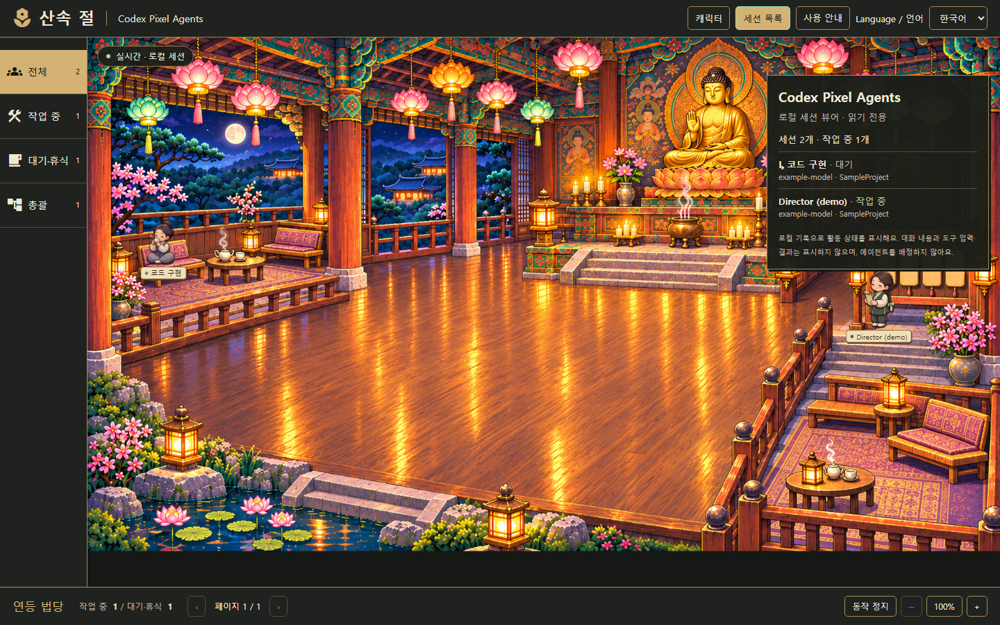
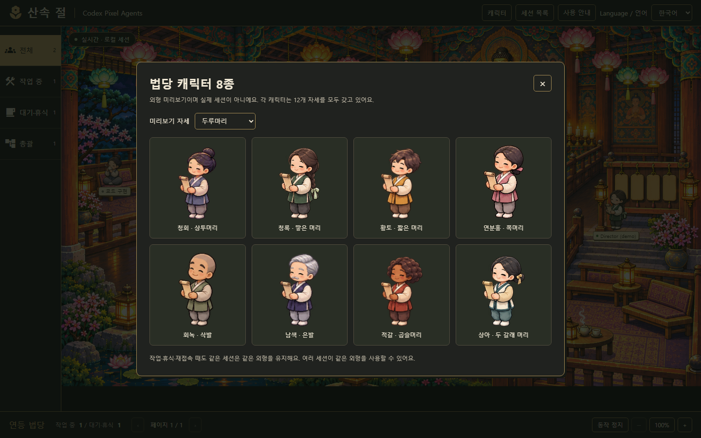

# Codex Pixel Agents

[English](README.md) · 한국어

**Codex 작업을 연등이 켜진 픽셀 법당에서 보여주는 로컬 뷰어입니다.**

[Pixel Agents](https://github.com/pixel-agents-hq/pixel-agents)를 기반으로, Codex Desktop·CLI의 로컬 세션 기록을 읽는 연동과 연등 법당 화면을 추가했습니다.


_화면은 개인정보가 없는 예제 세션입니다. 실제 Codex 테스트는 별도로 수행했습니다._

## 사용 방법

Node.js 22.12 이상과 npm이 필요합니다. Node 24에서 검증했습니다.

```sh
git clone https://github.com/Junghyeon0710/codex-pixel-agents.git
cd codex-pixel-agents
npm ci --ignore-scripts
npm run build
npm start
```

출력되는 **Local office** 주소를 브라우저에서 열고, Codex에서 평소처럼 작업하면 됩니다. 터미널은 켜두고 종료할 때 `Ctrl+C`를 누르세요. 이 포크는 npm·VS Code 마켓플레이스에 별도로 배포하지 않았습니다.

상단 메뉴의 **Language / 언어 → 한국어**를 선택하면 메뉴, 상태, 안내와 알려진 스튜디오 역할 이름이 한국어로 표시됩니다. 기본값은 영어이고, 선택한 언어는 브라우저 저장소를 사용할 수 있을 때 저장되어 새로고침해도 유지됩니다. 모델·도구·프로젝트·사용자 지정 역할 식별자는 원래 이름을 유지합니다.

**세션 목록**으로 목록을 숨기거나 다시 표시하고, **사용 안내**에서 상태별 의미를 확인할 수 있습니다. 메뉴 조작은 뷰어에만 적용되며 Codex 작업이나 설정을 변경하지 않습니다.

특정 프로젝트만 표시하려면:

```sh
npm start -- --workspace "D:/Unreal Projects/MyGame"
```

세션 작업 폴더와 정확히 일치해야 합니다. 별도 worktree라면 해당 경로를 지정하거나 필터를 빼세요.

```sh
npm start -- --port 4880 --recent-minutes 120
npm start -- --sessions-dir "C:/path/to/codex/sessions"
```

기본 입력은 `CODEX_HOME/sessions`, 환경변수가 없으면 `~/.codex/sessions`입니다. 최근 60분 이내에 갱신된 세션이 기본 표시 대상입니다.

## 무엇을 보여주나요?

상단 **캐릭터** 메뉴에서 머리·얼굴·옷이 다른 **8종**을 미리 볼 수 있습니다. 각 캐릭터는 절하기·차 마시기·독서·두루마리의 12개 자세를 갖고 있습니다. 같은 세션은 작업·휴식·재접속 때 외형을 유지하며, 서로 다른 세션은 외형이 겹칠 수 있습니다. [캐릭터 안내](docs/codex/TEMPLE-CHARACTERS.md)


_외형 미리보기이며 실제 에이전트 8명을 추가 실행한 화면이 아닙니다. 실제 세션도 법당에서 이 캐릭터 이미지들을 사용합니다._

- 실제 기록이 있는 세션과 하위 에이전트를 각각 캐릭터로 표시합니다.
- 모델, 역할, 프로젝트 폴더 이름, 실행 중인 도구 이름을 보여줍니다.
- 부모/자식 관계는 실제 메타데이터가 있을 때만 연결합니다.
- 작업 시작, 도구 실행·종료, 작업 완료, 브라우저 재접속을 반영합니다.

**에이전트를 배치하는 관리자가 아니라, 이미 실행 중인 Codex를 관찰하는 화면입니다.** “문 만들어줘”라고 했을 때 몇 명을 배치할지, 어떤 모델을 쓸지는 Codex와 스튜디오 프로젝트 설정이 결정합니다. 뷰어는 그 결과로 생긴 로컬 세션을 표시합니다. Codex 앱에 설치되는 사이드바 확장은 아닙니다.

## 상태와 한계

| 표시          | 의미                                                 |
| ------------- | ---------------------------------------------------- |
| `active`      | 작업 시작 또는 도구 호출이 기록됨                    |
| `idle`        | 작업 종료가 기록됨. 결과의 성공까지 보장하지 않음    |
| `interrupted` | 작업 중단 기록이 있음                                |
| `stale`       | 5분 넘게 기록 갱신이 없음. 프로세스 생존 여부는 모름 |
| `unknown`     | 해석 가능한 작업 상태 기록이 없음                    |

최근 파일 후보 200개에서 최대 24개 세션을 표시합니다. 내부 승인용 세션은 제외합니다. 64 MiB 초과 파일은 초기 재생에서 제외하고 UI에 알립니다. 2 MiB 초과 레코드는 건너뜁니다. 원격 클라우드 작업 등 로컬 JSONL 기록이 없으면 표시할 수 없습니다. Codex 내부 형식 변경으로 연동 수정이 필요할 수 있습니다.

Codex 뷰어는 **먹색·황동 테두리의 연등 법당**을 사용합니다. 작업 중인 전문가는 부처님을 향해 절하고, 대기 중인 에이전트는 양쪽 휴식 공간으로 이동합니다. 실제 관계가 확인된 총괄은 작업 중에 안내판 옆에 표시됩니다.

한 페이지에는 작업자 최대 12명, 대기·휴식 8명, 작업 중인 총괄 2명을 표시하고, 초과 인원은 다음 페이지에서 볼 수 있습니다. 세션 목록에는 발견된 전체 인원(백엔드 상한 24개)이 표시됩니다. 4명 고정 배치가 아니며, 기록이 없으면 빈 법당을 보여줍니다. 중단·상태 불명·오래된 기록은 절하지 않고, 연결 끊김·스캔 오류·동작 정지·동작 줄이기 설정에서도 애니메이션을 멈춥니다.

배치 편집·터미널·에이전트 실행·훅 설치는 비활성화되어 있습니다. 확대·축소 버튼, 스크롤 이동, 캐릭터 선택은 가능합니다. Unreal MCP 자체를 연결하는 프로그램도 아닙니다. [법당 동작과 이미지 출처](docs/codex/TEMPLE.md)를 참고하세요.

## 개인정보와 설정

로그를 로컬에서 읽되 프롬프트·답변·추론·도구 인자와 결과는 브라우저에 보내지 않습니다. 세션 ID, 역할·모델·도구 이름과 프로젝트 폴더의 마지막 이름은 전달하므로, 개인 작업 화면을 공유할 때 확인하세요.

서버는 `127.0.0.1`에서만 열리며 매 실행마다 바뀌는 토큰과 동일 Origin/Host를 검사합니다. 출력된 접속 주소에는 토큰이 있으므로 공개하지 마세요. Codex 설정·승인 정책·훅은 변경하지 않으며 명령 실행·파일 수정 API도 없습니다.

## 검증과 라이선스

새로운 실제 Codex CLI 세션을 읽기 전용으로 실행해 **세션 발견 → 도구 실행 → 도구 종료 → idle**을 확인했습니다. 파서·서버, 원본 프런트엔드, Chromium 화면 테스트도 별도로 수행했습니다. 범위와 결과는 [검증 기록](docs/codex/VALIDATION.md)에 있습니다.

최신 Windows 검증에서는 파서·서버 13개, 프런트엔드 195개, 브라우저 시나리오 4개와 타입 검사·린트·프로덕션 빌드가 통과했습니다. 실제 스튜디오의 기존 세션 기록 15개가 새 캐릭터로 표시되는 것도 확인했습니다. 완료·중단된 기록의 재생이며, 새 팀을 실행한 결과는 아닙니다. 작업 중 절 동작과 8종 전체는 별도 예제 세션으로 검증했습니다.

원본 MIT 저작권과 라이선스를 보존했습니다. 보존된 원본 사무실 캐릭터는 JIK-A-4의 MetroCity(CC0)이며, 법당 배경과 캐릭터는 이 프로젝트용으로 생성했습니다. 폰트는 FS Pixel Sans Unicode(OFL 1.1)입니다. [라이선스](LICENSE)와 [출처 고지](THIRD_PARTY.md)를 참고하세요. OpenAI 또는 원본 Pixel Agents 팀의 공식 제품은 아닙니다.
