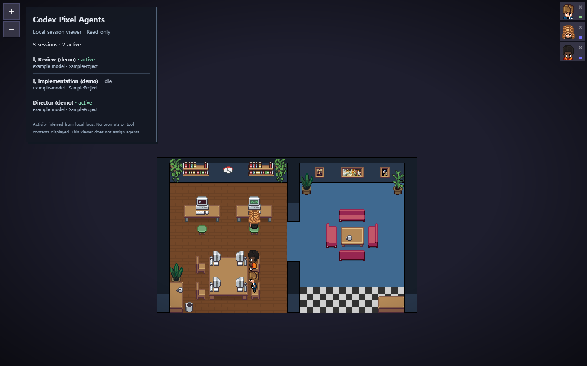

# Codex Pixel Agents

[](https://github.com/Junghyeon0710/codex-pixel-agents/actions/workflows/validate.yml)
[](LICENSE)

**Watch your local Codex sessions work in a pixel-art office.**

An independent [Pixel Agents](https://github.com/pixel-agents-hq/pixel-agents) adaptation for **Codex Desktop and CLI**. Keep using Codex normally; this local browser app turns recorded sessions and real subagents into animated office characters.

English · [한국어](README.ko.md)


_This screenshot uses synthetic demo sessions. Actual native Codex smoke-test results are recorded separately._

## What it does

- Discovers recent local sessions and updates about once per second.
- Displays activity, tool names, recorded model, role, and project folder name.
- Links child characters to a parent only when actual session metadata records that relationship. A spawn tool call alone does not create a fake worker.
- Restores the office after a browser reconnect or refresh.
- Reuses the upstream pixel renderer, furniture, characters and office layout.
- Runs locally with a read-only backend. No settings changes, hook installation, agent launching, terminal access, or remote service.

This is a **viewer**, not an agent manager. It does not make Codex delegate, choose models, or verify task success. Configure orchestration and models in Codex or your studio project; the viewer displays the resulting local sessions. It is a browser companion, not a native Codex sidebar extension.

## Quick start

Requires Node.js **22.12+** (Node 24 tested), npm, and a local Codex installation that writes session JSONL files.

```sh
git clone https://github.com/Junghyeon0710/codex-pixel-agents.git
cd codex-pixel-agents
npm ci --ignore-scripts
npm run build
npm start
```

Open the **Local office** URL printed in the terminal. Keep that terminal running, then start a task in Codex Desktop or CLI. Recent sessions appear as characters. Stop the viewer with **Ctrl+C**.

No npm package or VS Code Marketplace extension has been published for this fork. The commands above run the checked-out source. Original VS Code/Claude integration source remains for reference; `npm start` runs the new Codex-only viewer.

### Show one project

```sh
npm start -- --workspace "D:/Unreal Projects/MyGame"
```

The workspace match is exact (case-insensitive on Windows). A session in a different worktree needs that directory or no filter.

### Other options

```sh
npm start -- --port 4880 --recent-minutes 120
npm start -- --sessions-dir "/path/to/codex/sessions"
npm start -- --help
```

Default input: `$CODEX_HOME/sessions`, or `~/.codex/sessions` when unset. Default port: **4877**. Default recency: **60 minutes**. Old sessions expire from view; restarting the viewer does not restart Codex.

## Activity and privacy

| Display       | Evidence                                                         |
| ------------- | ---------------------------------------------------------------- |
| `active`      | Recorded turn start or tool call                                 |
| Tool name     | Function/custom tool call without a matching output yet          |
| `idle`        | Recorded task completion; does not prove task success            |
| `interrupted` | Recorded turn abortion                                           |
| `stale`       | Active state with no update for over 5 minutes; liveness unknown |
| `unknown`     | Metadata exists without a recognized lifecycle event             |

The backend reads transcript bytes locally and discards content outside a metadata allowlist. It does **not** send prompts, replies, reasoning, tool arguments/results, auth files, or full workspace paths to the browser. Session identifiers, role/model/tool names, and the project **basename** are sent to the local browser; these labels can still be personal information. Check screenshots before sharing private work.

The server binds only to `127.0.0.1`. WebSocket access requires a random per-run token and the exact local Origin/Host. The printed URL contains that token: keep it private. Restarting rotates it. There are no write or command-execution endpoints. Do not expose the service through a public tunnel.

## Compatibility and limits

- Verified with native **Codex CLI 0.167.0-alpha.3.2** on Windows and the Desktop-style local schema present during development. Transcript JSONL is an internal format and may change.
- Cloud-only sessions or clients without accessible local JSONL are not visible.
- Discovery scans up to four directory levels, considers 200 recent candidate files, and displays up to 24 sessions. Internal approval/guardian sessions are excluded.
- Initial replay skips files larger than 64 MiB (reported in the UI). Individual records above 2 MiB are skipped; following records continue normally.
- Activity comes from logs, not a process heartbeat. Permission dialogs, commands hidden inside an `exec` wrapper, and exact progress percentages are not inferred.
- This first version uses a fixed upstream office layout. Layout editing, hooks, terminals, sound, and agent launching are disabled. Zoom/pan and character selection remain available.
- This viewer does not connect to Unreal MCP. It can display Codex sessions using Unreal tools just like other tool activity.

## Development and verification

```sh
npm test                        # Codex parser, tailing, privacy and server tests
npm run check-types             # Retained TypeScript code
npm run build                   # Backend + production browser app
npm run test:webview            # Retained renderer/editor unit tests
npx playwright install chromium
npm run test:codex-ui            # Real Chromium with synthetic sessions
```

CI runs these checks on Windows and Ubuntu without Codex credentials or AI calls. See [validation notes](docs/codex/VALIDATION.md) for unit tests, synthetic browser tests, and the actual native Codex smoke test.

```text
codex/session-monitor.mjs  JSONL reducer and incremental read-only scanner
codex/server.mjs           Loopback HTTP/WebSocket server
codex/cli.mjs              CLI options and startup
codex/tests/               Parser, tailing and server tests
codex/ui.spec.mjs          Production browser integration test
webview-ui/               Upstream pixel office + Codex activity panel
server/, core/, adapters/  Retained upstream implementation
```

## Credits and license

Based on **Pixel Agents by Pablo De Lucca and contributors**, upstream commit `b1bafd0`. Original MIT notices and source history are retained. New Codex integration is MIT licensed. Character sprites credit **JIK-A-4 / MetroCity (CC0)**; **FS Pixel Sans Unicode** uses **OFL 1.1**. See [LICENSE](LICENSE) and [third-party notices](THIRD_PARTY.md).

Not affiliated with or endorsed by OpenAI or the Pixel Agents maintainers. The historical [UPSTREAM.md](UPSTREAM.md) retains the original README; its Claude/Marketplace instructions do not describe this fork's setup.
