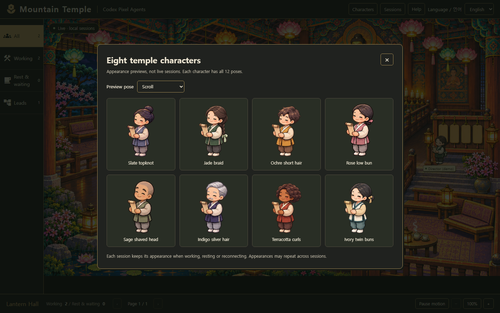

# Eight temple characters

The Codex viewer now ships eight appearances: the original slate topknot plus seven new identities. All eight include the same 12 poses: eight bow phases, two tea poses, reading and a coordinator scroll pose. No hue filter is used; hairstyles and face details are drawn in each atlas.

Open **Characters** in the top menu to inspect all eight appearances. The gallery is explicitly a preview, not a live team. Its pose selector shows the actual production sprites.

## Assignment

The native session ID is hashed into the eight-appearance catalog. Work/rest changes, browser reloads, reconnects, role changes and backend numeric ID changes do not change that session's appearance. Old payloads without a native ID fall back to the numeric ID. Appearances are not exclusive: separate sessions may share one, and more than eight sessions necessarily reuse appearances. The viewer still does not spawn or assign work to agents.

## Assets and validation

- Base: `webview-ui/public/temple/agents.png` (slate).
- New atlases: `webview-ui/public/temple/characters/{jade,ochre,rose,sage,indigo,terracotta,ivory}.png`.
- Metadata: `webview-ui/src/temple/characters.json`.
- `node codex/temple-atlas.mjs` validates true transparency and 12 nonempty, padded frame bounds per atlas, then regenerates metadata without altering any image.
- Rendering uses each atlas's own frame bounds and one fixed character scale. Bowing is not stretched to standing height.

## Generation prompts

Built-in image-generation tool; true transparent background; original 4×3 slate atlas used as pose/style reference. One separate generation call per new identity. The original slate generation prompt is recorded in `TEMPLE-ART-PROMPTS.md`.

### Shared prompt

Use case: precise-object-edit. Production animation atlas variant, TRUE TRANSPARENT BACKGROUND. Edit the attached 4-column by 3-row sprite atlas: change ONLY the character's identity, hair silhouette, complexion and clothing palette consistently in ALL 12 cells. Preserve the same polished pixel-art chibi style, matching head/body scale, camera, frame ordering, spacing, and exact body poses. Exactly 12 sprites in an evenly divided 4x3 grid, generous transparent padding. No text, labels, grid, background, mats or ground; true alpha. First 8 row-major cells rear three-quarter looking upper-right: standing prayer, half squat, kneeling prayer, hands reaching down, FULL forehead-to-ground prostration (feet lower-left, head upper-right), lifting torso hands planted, upright kneeling, rising. Bottom row: cross-legged tea cup lowered, same pose tea sipping, seated reading open book, standing coordinator holding scroll front three-quarter facing left. Do not change pose order or facing direction. Each atlas depicts ONE consistent character, with identical clothing and hairstyle across all 12 poses. Avoid scattered opaque pixels or colored edge fringe. Important: hair/face change is required, not just color swapping. Character specification:

### Identity specifications

- **jade (청록 · 땋은 머리)**: young woman, single neatly braided dark-brown plait down her back tied with a pale jade ribbon, soft oval face, deep jade-green vest over ivory sleeves, charcoal trousers. The BRAID must be clearly visible in every rear-facing bow pose, replacing the topknot.
- **ochre (황토 · 짧은 머리)**: young man, short softly tousled dark chestnut hair, no bun, no ponytail, slightly round face, ochre/mustard-gold sleeveless hanbok vest over cream sleeves and brown trousers. Clear SHORT HAIR silhouette on rear views.
- **rose (연분홍 · 쪽머리)**: adult woman, low rounded black hair bun at nape with a small pink ribbon, soft rounded cheeks, dusty rose-pink hanbok vest, ivory sleeves and warm gray trousers. LOW BUN rather than topknot. No long loose hair.
- **sage (회녹 · 삭발)**: adult male monk, clean SHAVED head, warm medium tan skin, kind broad face, muted sage-green and warm stone-gray monk's robes in the same short vest/sleeves silhouette as reference with gray trousers. No hair, no hat. Do not add beads or accessories that complicate poses.
- **indigo (남색 · 은발)**: older adult man with short neatly combed SILVER-GRAY hair, small silver eyebrows and subtle short gray moustache, gentle narrow eyes, deep midnight-indigo vest with ivory sleeves and light gray trousers. Clearly silver-haired in rear poses, no topknot.
- **terracotta (적갈 · 곱슬머리)**: adult woman with a short dark-brown CURLY BOB with clear rounded curls, warm deep-brown skin, warm terracotta-red hanbok vest, oatmeal sleeves and dark brown trousers. Curly hair silhouette visible from behind; no bun.
- **ivory (상아 · 두 갈래 머리)**: young adult woman with two small LOW SIDE BUNS tied with muted golden ribbons, black hair, bright rounded face, ivory/light-cream vest with narrow dark-teal trim over soft sand sleeves and teal-gray trousers. Two side buns remain recognizable in all rear bow poses, not single topknot.
