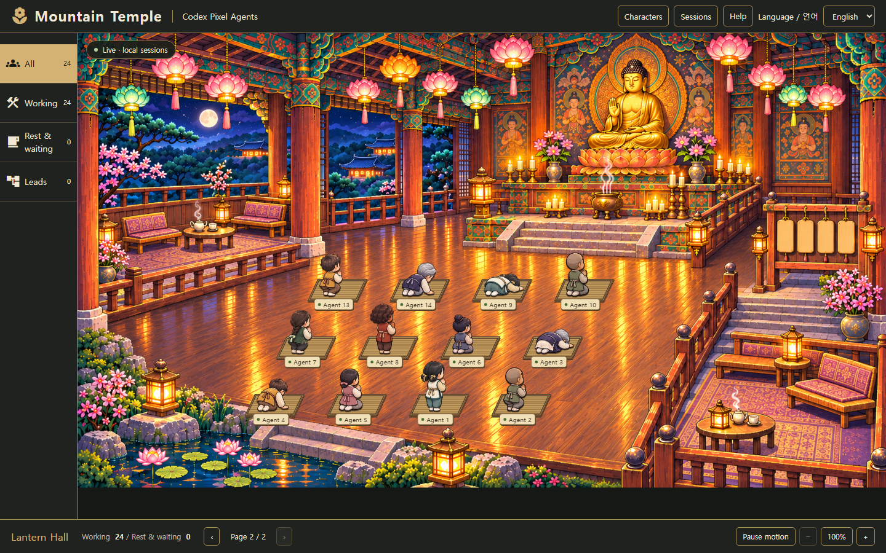
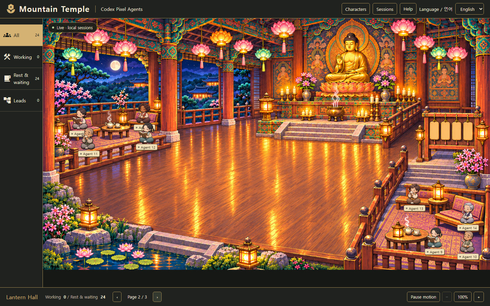

# Lantern Hall

The Codex build uses the selected lantern temple with charcoal (`#20221f`) and brass (`#a48b54`) menus. The original office implementation remains available in the upstream source/build; the Codex production entry point mounts `TempleView` instead.

## Recorded activity, not a simulation

Every character comes from a `codexSessions` record. There are no decorative workers or default four-person team. A blank monitor produces an empty hall. The viewer never assigns tasks or changes models.

- Active specialists perform an eight-pose bow toward the Buddha, with independent timing.
- Active leads stand at the side board. A lead needs a recorded child relationship or the explicit `technical-director` role; an arbitrary root session is not automatically labeled a manager.
- Idle sessions sit in the side lounges and read or drink tea. This means a turn ended, not that it succeeded.
- Interrupted, stale and unknown sessions have a stationary pose and retain their actual status in their accessible name and detail card.
- Motion stops when disconnected, while a session scan has failed, when paused, or when the browser requests reduced motion. Reconnection sends a fresh handshake before resuming.
- Character selection exposes only the existing allowlisted role, model, project basename and tool names. The complete session list remains available in the top menu.

## Population and navigation

A page has 12 prayer positions, 8 lounge positions and 2 coordinator positions. Overflow uses additional pages without shrinking characters into an unreadable crowd. The backend still discovers at most 24 recent sessions; pagination does not change that limit. Counts describe all discovered sessions, while the page indicator describes the currently selected activity filter. Choosing a session in the list reveals its page.

Filters: all, working, rest/waiting, and recorded leads. Zoom buttons enlarge the scene up to 300%; scrolling pans the enlarged scene. Fit resets to the complete scene. English remains the default and the existing Korean preference is preserved.

## Artwork

The viewer has **eight character appearances**, each with all 12 poses. Hair, facial details and clothing palettes differ. Native session identity determines the appearance so state changes do not swap a character. The top-menu Characters gallery previews every appearance without inventing live agents. See [character assets, assignment and prompts](TEMPLE-CHARACTERS.md).

- `webview-ui/public/temple/lantern-hall.png`: empty environment, no baked-in people or UI.
- `webview-ui/public/temple/agents.png`: transparent 4×3 atlas, eight rear three-quarter bow poses, two tea poses, a reading pose and a coordinator pose.
- `webview-ui/public/temple/characters/`: seven additional complete character atlases.
- `webview-ui/src/temple/characters.json`: per-character alpha-bounded sprite rectangles. Frames share a scale and ground anchor; short bow poses are not stretched to standing height. `atlas.json` is the retained original atlas metadata.
- CSS draws the real controls and dynamically occupied straw mats. The illustration contains no clickable mock controls.

The background and atlas were generated with the built-in image-generation tool for this adaptation, from the user-selected temple mockup. They are separate from the retained MetroCity office assets. The prompts used are saved in `TEMPLE-ART-PROMPTS.md`. No image service is contacted by the running viewer.

## Validation images

The following screenshots use **synthetic test transcripts**, not real agent work:

Browser integration checks cover incremental state changes, privacy, locale persistence, reduced motion, pause/resume, selection, zoom, 24 active sessions, 24 resting sessions, interruption, reconnection, empty state and a 390-pixel mobile viewport. See `VALIDATION.md` for the recorded run.
